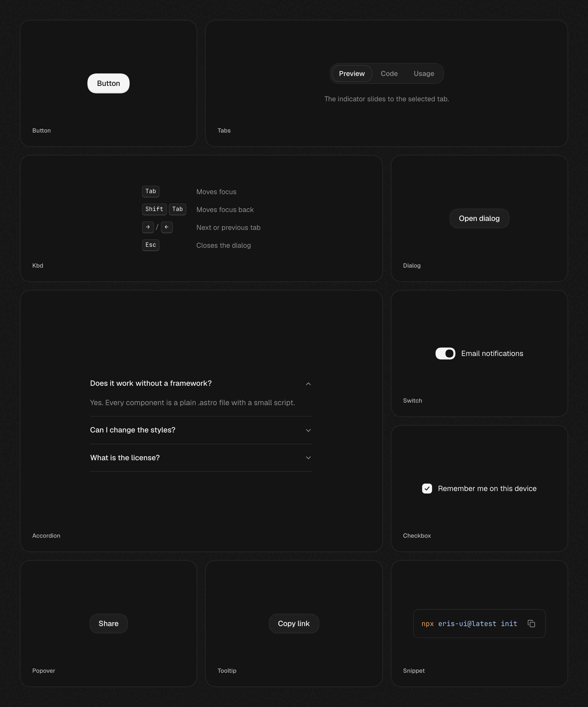

# Eris UI

Accessible UI components you can drop into any Astro project. Plain `.astro` files, behaviour from [Zag](https://zagjs.com) state machines, styled with Tailwind v4. **No framework islands.**

## Documentation

Visit [https://erisui.dev/docs](https://erisui.dev/docs) to view the documentation.

## Contributing

Please read the [contributing guide](./CONTRIBUTING.md).

## License

Licensed under the [MIT license](./LICENSE).
